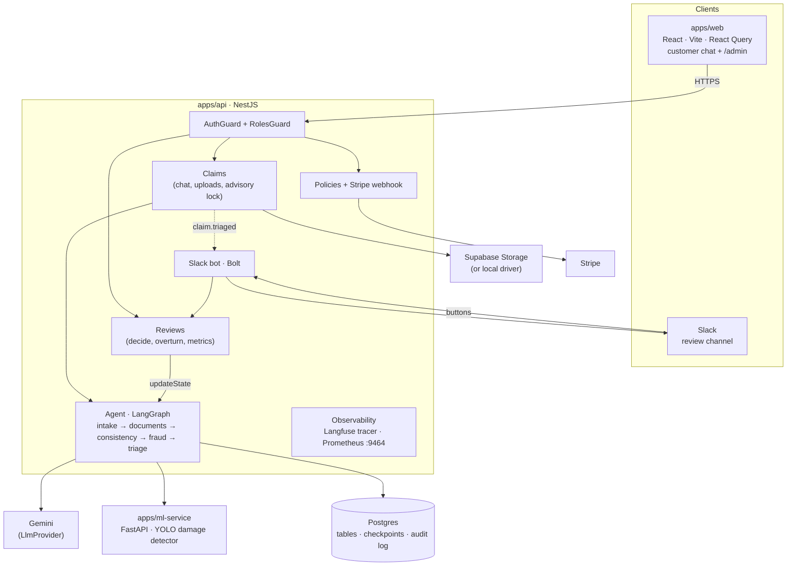

# ClaimPilot

An AI-assisted motor-insurance claims platform. Customers buy a policy, then file a claim through a conversational agent that collects incident details, gathers required documents, and — critically — **triages claims to human reviewers rather than auto-deciding them**. Built as a production-shaped system: typed end to end, idempotent payments, an agent whose state survives restarts, and an append-only audit trail.

> **Status:** feature-complete for sprint 1. Payments, the claims agent (intake → documents → VLM + YOLO consistency analysis → fraud checks → rule-based triage), the reviewer dashboard, the Slack bot, the eval gate in CI, and the Kubernetes/monitoring setup all exist. This README is explicit about what is verified and what isn't yet (see *Verification status*).

---

## Why this project exists

Most "AI agent" demos are a chat loop wrapped around an LLM. Real claims processing can't work that way — it has stages with rules (you can't analyze damage before documents arrive), it handles money, and a wrong automated decision has legal and financial consequences. ClaimPilot is built around that reality:

- The agent is a **state machine**, not an LLM free-for-all. Control flow lives in code you can read, test, and reason about; the LLM is a tool called *inside* a stage to do language work, never the thing deciding what happens next.
- The agent **triages, it does not auto-approve.** Its job is to prepare a claim and route it to a human, which is the responsible design for a high-stakes domain.
- Everything that matters is **auditable and recoverable** — an append-only event log records what happened, and agent state is checkpointed to Postgres so an in-progress claim survives a server crash or redeploy.

---

## Architecture



| Package | Purpose |
|---|---|
| `apps/api` | NestJS: Policies, Claims, Agent, Reviews, Slack, Observability; `evals/` and `scripts/seed.ts` |
| `apps/web` | React + Vite SPA: buy, chat with uploads, `/admin` review dashboard |
| `apps/ml-service` | Python FastAPI + Ultralytics YOLO car-damage detector |
| `packages/db` | Drizzle schema + SQL migrations (+ runtime migrator for containers) |
| `packages/shared` | Zod schemas, plans, **triage rules as data** |
| `infra/` | raw k8s manifests, Helm chart, monitoring values + dashboard, k6, drills |

---

## Technical highlights

### Triage, not auto-approval — with rules you can read
The agent produces a **priority** (which queue) and an advisory **recommendation**; a human always decides. The rules are data in [`packages/shared/src/triage.ts`](packages/shared/src/triage.ts): thresholds, the flags that escalate, and how flags map to a recommendation. No rule lives in a prompt. When a reviewer disagrees with the recommendation, the review is stored as an **overturn**, the primary agent-quality metric.

### Two opinions on every photo
The consistency node calls a **VLM** (Gemini; strict JSON, Zod-validated) and a **specialist detector** (YOLO in `ml-service`) in parallel. If they disagree on whether there's damage, that's itself an escalation flag. Cheap deterministic fraud checks sit beside them: SHA-256 duplicate photos across claims, EXIF capture date far from the incident, and stock/screenshot detection.

### Failure never blocks the customer
If the VLM or ML service times out, errors, rate-limits, or returns garbage, the claim still reaches a human, flagged `analysis_incomplete` with the reason. The live evals hit Gemini's free-tier quota mid-run and every affected claim degraded exactly this way.

### Evals gate CI
A 22-case golden set (real Commons photos + synthetic screenshot/EXIF/duplicate cases, with correct and deliberately mismatched descriptions) runs through the **production graph**. CI replays recorded model outputs (deterministic, free, no secrets) and fails if description-match accuracy, false-flag rate or missed-flag rate regresses past `evals/baseline.json`. A prompt change misses the cache, which forces a fresh live recording. The vision model was **chosen by this suite**, not by vibes (see DECISIONS.md). An LLM-as-judge script grades conversational quality (field collection, no hallucinated policy terms).

### Idempotent Stripe webhooks
Payment confirmation rides a signed, server-to-server **webhook**, never the browser redirect. Stripe delivers *at least once*, so duplicates are expected: each event ID is a primary key in `processed_webhook_events`, and the dedup insert and activation happen in one transaction.

### A checkpointed state machine that survives restarts and scales out
Agent state is checkpointed to Postgres after every node, so any API instance can serve any turn and a crash loses nothing. Per-claim `pg_advisory_xact_lock` serialises concurrent turns *across replicas*. Assessment writes are idempotent (`runId` as the primary key).

### Auditable by construction
`claim_events` is append-only, **enforced by a database trigger**. The chat transcript and the admin audit timeline are projections of that log. Reviews, status changes, escalations, and agent assessments are all events.

### Observable
Every agent turn is a Langfuse trace (LLM generations with tokens/latency/cost, the ML call as a span). Prometheus scrapes an internal-only port: HTTP latency by route template, LLM calls/latency/cost, the claims funnel, and triage/decision counters. One Grafana dashboard plus alert rules (5xx spike → Slack).

---

## Tech stack

**Backend:** NestJS · TypeScript (strict) · Drizzle · PostgreSQL · LangGraph · Zod · Bolt (Slack)
**AI:** Gemini (flash-lite, behind `LlmProvider`) · Ultralytics YOLO (FastAPI) · Langfuse
**Frontend:** React · Vite · React Router · TanStack Query
**Delivery:** Docker (multi-stage, non-root) · GitHub Actions · GHCR · k3d · Helm · Traefik · kube-prometheus-stack · k6

---

## Running locally

```bash
pnpm install
docker compose up -d                      # Postgres on :5433
pnpm build:packages                       # shared + db must build before the API
pnpm migrate                              # packages/db/.env DATABASE_URL
pnpm seed                                 # demo reviewer, customer, 5 triaged claims (no API key needed)

# ml-service (Python 3.12)
cd apps/ml-service && uv venv --python 3.12 .venv && uv pip install --python .venv/bin/python -r requirements-dev.txt
.venv/bin/python scripts/download_model.py && .venv/bin/uvicorn app.main:app --port 8010

pnpm --filter api start:dev               # :3000 (metrics on :9464)
pnpm --filter web dev                     # :5173
stripe listen --forward-to localhost:3000/webhooks/stripe
```

To review claims as yourself: sign up in the web app, then `SEED_PROMOTE_EMAIL=you@example.com pnpm seed`.

| Command | What |
|---|---|
| `pnpm lint` / `pnpm typecheck` | both apps |
| `pnpm test` | unit tests (rules, cross-check, schemas, Slack signature) |
| `pnpm test:int` | real graph + Postgres; fake LLM/ML (needs the docker DB) |
| `pnpm eval` | eval gate (replay); `EVAL_MODE=record` fills missing cassettes live |
| `pnpm --filter api judge` | LLM-as-judge over scripted conversations (live) |
| `docker compose --profile full up --build` | whole stack in containers |

Kubernetes (k3d + Helm): `infra/k8s/k3d-up.sh`, `infra/k8s/create-secrets.sh`, `infra/k8s/deploy.sh`. Rollback drill: `infra/k8s/rollback-drill.sh`. HPA load: `k6 run infra/k6/hpa-load.js`. Monitoring: see `infra/monitoring/kube-prometheus-stack.values.yaml`.

---

## Verification status

| Area | Verified how |
|---|---|
| Agent flow, fraud, triage, reviews, reconciliation, locking | 20 integration tests on real Postgres (fake LLM/ML) |
| Prompts on real models | live Gemini runs: intake conversations, 22-case eval, LLM-as-judge (4/4 pass) |
| ml-service | pytest + live inference on the golden photos |
| Admin + chat UI | exercised in a browser against the real API (auth stubbed locally) |
| All three images | built; api smoke-tested (ready, metrics port isolation, non-root) |
| Helm chart on k3d (k8s 1.35) | deployed: ingress `/` + `/api`, metrics not public, migrations hook, rolling upgrade |
| DB outage at boot | Postgres stopped while an API pod booted: readiness 503 / liveness 200, retried, 0 restarts |
| Rollback drill | broken image → rollout stalled, `helm rollback`; **99/99 requests 200 during the drill** |
| HPA | k6, 200 VUs: 2 → 6 pods in ~45s, scaled down after the 2-min window; **986,884 requests, 0 failed, p95 19 ms** |
| Monitoring | kube-prometheus-stack: 3 targets up, 4 alert rules loaded, Grafana dashboard provisioned |
| CI workflow, Slack against a real workspace, Langfuse cloud, Supabase storage driver in k8s | written, **not yet run** |

---

## Notes on scope

This is a portfolio project built to production shape, not a production deployment. Deliberate simplifications: token validation is a network round trip (local JWT verification is the scale path); notifications use an in-process event bus (a durable queue is sprint 2); the local Postgres in Helm stands in for a managed DB. Motor insurance keeps it clear of health data and HIPAA scope. Every tradeoff is in [`DECISIONS.md`](DECISIONS.md).
