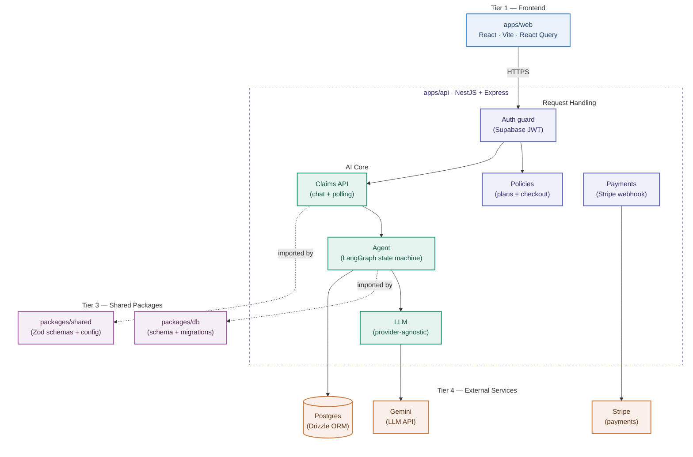

# ClaimPilot

An AI-assisted motor-insurance claims platform. Customers buy a policy, then file a claim through a conversational agent that collects incident details, gathers required documents, and — critically — **triages claims to human reviewers rather than auto-deciding them**. Built as a production-shaped system: typed end to end, idempotent payments, an agent whose state survives restarts, and an append-only audit trail.

> **Status:** actively building. The core platform — authentication, payments, and the claims agent — is fully working and deployed. AI fraud analysis, the reviewer dashboard, and the Kubernetes/observability stack are on the roadmap below. This README describes what exists today and is explicit about what doesn't yet.

---

## Why this project exists

Most "AI agent" demos are a chat loop wrapped around an LLM. Real claims processing can't work that way — it has stages with rules (you can't analyze damage before documents arrive), it handles money, and a wrong automated decision has legal and financial consequences. ClaimPilot is built around that reality:

- The agent is a **state machine**, not an LLM free-for-all. Control flow lives in code you can read, test, and reason about; the LLM is a tool called *inside* a stage to do language work, never the thing deciding what happens next.
- The agent **triages, it does not auto-approve.** Its job is to prepare a claim and route it to a human, which is the responsible design for a high-stakes domain.
- Everything that matters is **auditable and recoverable** — an append-only event log records what happened, and agent state is checkpointed to Postgres so an in-progress claim survives a server crash or redeploy.

---

## Architecture



**Monorepo** (pnpm workspaces):

| Package | Purpose |
|---|---|
| `apps/api` | NestJS backend — auth, payments, claims agent |
| `apps/web` | React + Vite single-page app |
| `packages/db` | Drizzle schema + SQL migrations, shared by API and tooling |
| `packages/shared` | Zod schemas and plan config shared by API and web (one source of truth) |

---

## Technical highlights

These are the decisions worth reading the code for.

### Idempotent Stripe webhooks
Payment confirmation rides a signed, server-to-server **webhook**, never the browser redirect — the redirect is cosmetic UX, the webhook is the source of truth. Stripe guarantees *at-least-once* delivery, so duplicates are expected. Each event's ID is a primary key in a `processed_webhook_events` table; a duplicate delivery hits a unique-constraint violation and is safely ignored. The dedup insert and the policy activation happen in **one transaction**, so "recorded as processed" and "actually processed" can never diverge — even under concurrent delivery.

### The claims agent as a checkpointed state machine
Built with **LangGraph**. The claim moves through explicit nodes — intake → document collection → (analysis → triage, roadmap) — with **conditional edges** that route on accumulated state. The agent's entire knowledge lives in one typed state object, which is **checkpointed to Postgres after every step**. Consequences:

- A crash or redeploy mid-claim loses nothing — a new process loads the checkpoint and resumes.
- Any API instance can serve any request, because state lives in the datastore, not process memory. No sticky sessions.

This is the same principle applied three times across the codebase — stateless services, state in a shared store — and it's what makes the system horizontally scalable (JWT auth holds no server session; webhook dedup lives in the DB; agent state is checkpointed).

### Provider-agnostic LLM layer
Every model call goes through an `LlmProvider` interface, bound to a concrete implementation (Gemini) by a single line of dependency injection. Swapping models is an env-var change; testing is done by injecting a fake provider that returns canned output. LLM responses are treated as **untrusted input** — every extraction is validated against a Zod schema before it's allowed into state, because model output drifts in shape, not just content.

### Append-only audit log
Every meaningful action writes an immutable `claim_events` row. The chat transcript itself is a *projection* of this log — messages aren't stored separately, they're read back from the event stream. One source of truth; full history for free.

### Typed end to end
Drizzle for typed SQL, Zod for runtime validation at every trust boundary (API inputs and LLM outputs), shared types between backend and frontend via the `shared` package. A schema is defined once and enforced everywhere.

---

## Tech stack

**Backend:** NestJS · Express · TypeScript · Drizzle ORM · PostgreSQL · LangGraph · Zod
**Frontend:** React · Vite · React Router · TanStack Query (React Query)
**Infrastructure:** Supabase (Auth + hosted Postgres) · Stripe · Google Gemini · Docker Compose
**Deployment:** Render (API) · Vercel (web) · Supabase (database)

---

## What's built

- **Authentication** — Supabase Auth with a NestJS guard validating JWTs on protected routes.
- **Policy purchase** — plan selection, vehicle registration, Stripe Checkout, and idempotent webhook-driven activation. Verified end to end with Stripe test mode.
- **Claims agent** — conversational intake that extracts structured incident details from free-form text, validates policy coverage, collects required documents, and advances through a checkpointed LangGraph state machine.
- **Chat UI** — a polling-based claims chat (TanStack Query) that surfaces agent replies without a refresh.
- **Deployed** — the full stack runs on the public internet (Vercel → Render → Supabase).

## Roadmap

Planned, not yet built:

- **Vision-based damage analysis** — a VLM cross-checking damage photos against the incident description for consistency, plus rule-based fraud signals, feeding a triage decision.
- **Reviewer dashboard** — a role-gated admin surface for humans to review triaged claims and record decisions.
- **Dedicated ML service** — a Python service (e.g. YOLOv8) for object detection on damage photos, called by the agent.
- **Evaluation harness** — a golden dataset and an automated eval suite that gates CI merges on agent-accuracy regression, with per-claim cost and latency tracing.
- **Kubernetes deployment** — Helm charts, horizontal pod autoscaling, health/readiness/liveness probes, and a Prometheus/Grafana observability stack.

---

## Running locally

**Prerequisites:** Node (see `.nvmrc`), pnpm, Docker, and accounts for Supabase, Stripe (test mode), and Google Gemini.

```bash
# 1. Install
pnpm install

# 2. Start Postgres
docker compose up -d

# 3. Build shared packages (required before the API compiles)
pnpm --filter @claimpilot/db build
pnpm --filter @claimpilot/shared build

# 4. Apply migrations
pnpm --filter @claimpilot/db migrate

# 5. Run API and web (separate terminals)
pnpm --filter api start:dev
pnpm --filter web dev

# 6. For local payment testing, forward Stripe webhooks
stripe listen --forward-to localhost:3000/webhooks/stripe
```

Environment variables are documented per app in `apps/api/.env.example` and `apps/web/.env.example`. The API needs Supabase, Stripe, and Gemini credentials; the web app needs the Supabase URL/anon key and the API URL.

---

## Notes on scope

This is a portfolio project built to production shape, not a production deployment. Some deliberate simplifications: authentication uses a network round-trip to validate tokens (local signature verification is the documented scale-up path); local development uses Docker Postgres while the deployed environment uses Supabase; and the domain is motor insurance specifically to keep it clear of health data and HIPAA scope. Design decisions and their tradeoffs are documented in `DECISIONS.md`.